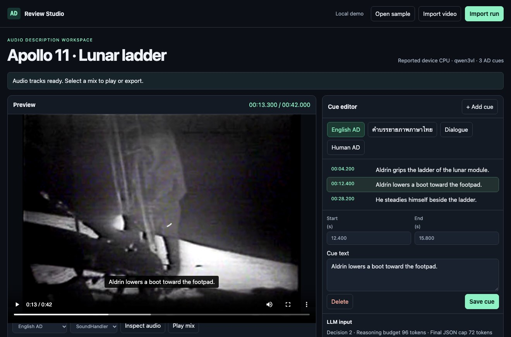

# Audio Description Studio

Generate, inspect, and edit audio descriptions for video on your own machine.
The Studio runs locally with Docker Compose. Import an MP4, start a job, and
review the suggested narration alongside the original dialogue. Export cues
as WebVTT or save a reviewed MP4.



## Quick start

Install [Docker with Compose](https://docs.docker.com/compose/install/) and the
[Hugging Face CLI](https://huggingface.co/docs/huggingface_hub/guides/cli) for
the initial checkpoint download.

```bash
git clone https://github.com/hereisamara/audio-description.git
cd audio-description

hf download openai/whisper-tiny.en --local-dir models/whisper-tiny.en
hf download facebook/mms-tts-eng --local-dir models/mms-tts-eng-local
hf download Qwen/Qwen3-VL-2B-Instruct-GGUF \
  Qwen3VL-2B-Instruct-Q4_K_M.gguf mmproj-Qwen3VL-2B-Instruct-Q8_0.gguf \
  --local-dir models/qwen3-vl-2b-instruct-gguf

docker compose up --build -d
```

Open [Studio](http://127.0.0.1:7860). Choose **Import video**, pick an MP4
with an audio stream, and select **Start job**. Keep **Auto** for the default
profile. Choose **Inspect dialogue and gaps** as soon as Whisper finishes.
Open completed jobs under **Recent jobs** and use the right panel to edit cues
or export the result. Use **Import run** to review results from another host.

The initial build and downloads need internet access. Inference uses the
staged models offline. Compose stores uploads, job state, and results in
the local `job-data` volume. `docker compose stop` stops the services and
keeps the volume.

## How it works

1. **Studio** uploads the source once, queues the job, and streams review
   media to the browser.
2. **Whisper** transcribes audio and writes dialogue timing and candidate
   gaps to SQLite.
3. **AD Maker** reviews timestamped video frames with recent dialogue,
   places short descriptions, synthesizes narration with MMS-TTS, and
   renders a selectable AD track.

Click a VLM marker to inspect the saved prompt, selected frames, and reply.
The timeline also shows shots, scenes, dialogue, and placed cues. Review the
draft cues before publishing, especially around missed or overlapping dialogue.


The screenshots use illustrative cue and timing data with public-domain
Apollo 11 footage digitized by Kipp Teague. [NASA Apollo 11 Video Library](https://www.nasa.gov/wp-content/uploads/static/history/alsj/a11/video11.html)

## Optional models

**Cue editor.** Stage Qwen3-1.7B to have AD Maker rewrite drafts into short,
grounded narration using the dialogue and available time. Compose detects
the checkpoint automatically.

```bash
hf download Qwen/Qwen3-1.7B-GGUF Qwen3-1.7B-Q4_K_M.gguf --local-dir models/cpu-llm
docker compose up -d --force-recreate ad-maker
```

**NVIDIA CUDA.** On an x86-64 Linux host with [NVIDIA GPU support for Docker](https://docs.docker.com/compose/how-tos/gpu-support/),
Auto can use Whisper Small English and Qwen3-VL-8B-Instruct. The default
Compose file uses the Qwen3-VL-2B CPU profile.

```bash
hf download openai/whisper-small.en --local-dir models/whisper-small.en-transformers
hf download Qwen/Qwen3-VL-8B-Instruct --local-dir models/Qwen3-VL-8B-Instruct
hf download facebook/mms-tts-eng --local-dir models/mms-tts-eng

docker compose -f compose.yaml -f compose.cuda.yaml up --build -d
```

For the worker contracts, API, and standalone pipeline commands, see the
[worker integration guide](docs/worker-integration.md). The
[Lanta POC branch](https://github.com/hereisamara/audio-description/tree/lanta-poc)
contains the Slurm launchers and research benchmarks.
