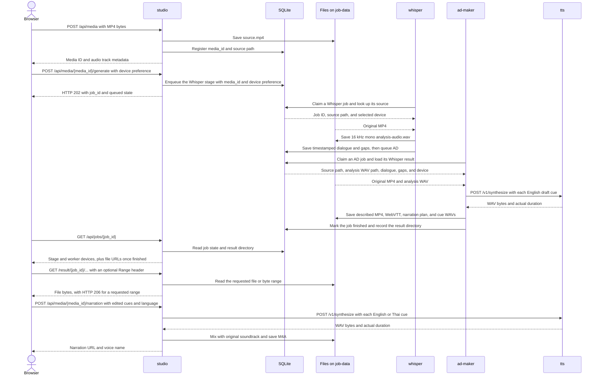
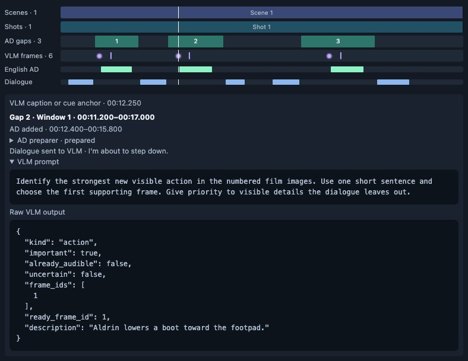

# Audio Description Studio

Generate, inspect, and edit audio descriptions for video on your own machine.
The Studio runs locally with Docker Compose. Import an MP4, start a job, and
review the suggested narration alongside the original dialogue. Export cues
as WebVTT or save a reviewed MP4.


## Quick start

Install [Docker with Compose](https://docs.docker.com/compose/install/) and the
[Hugging Face CLI](https://huggingface.co/docs/huggingface_hub/guides/cli) for
the initial checkpoint download.

```bash
git clone https://github.com/hereisamara/audio-description.git
cd audio-description

hf download openai/whisper-tiny.en --local-dir models/whisper-tiny.en
hf download facebook/mms-tts-eng config.json tokenizer_config.json special_tokens_map.json vocab.json model.safetensors \
  --local-dir models/mms-tts-eng-local
hf download facebook/mms-tts-tha config.json tokenizer_config.json special_tokens_map.json vocab.json model.safetensors \
  --local-dir models/mms-tts-tha
hf download Qwen/Qwen3-VL-2B-Instruct-GGUF \
  Qwen3VL-2B-Instruct-Q4_K_M.gguf mmproj-Qwen3VL-2B-Instruct-Q8_0.gguf \
  --local-dir models/qwen3-vl-2b-instruct-gguf

docker compose up --build -d
```

Open [Studio](http://127.0.0.1:7860). Choose **Import video**, pick an MP4
with an audio stream, and select **Start job**. Keep **Auto** for the default
profile. Choose **Inspect dialogue and gaps** as soon as Whisper finishes.
Open completed jobs under **Recent jobs** and use the right panel to edit cues
or export the result. Use **Import run** to review results from another host.
In the audio panel, choose English or Thai and select **Generate AD audio**
after adding or importing cues in that language. Automatic jobs draft
English cues. For Thai audio, add, import, or translate Thai cues before
selecting **Generate AD audio**.

The initial build and downloads need internet access. Inference uses the
staged models offline.

## Docker specifications

- All four services use Linux-based Micromamba images. On macOS, Docker Desktop runs them in a Linux VM.
- The default Compose profile runs on CPU. The CUDA override runs Whisper and AD Maker on an x86-64 Linux host with an NVIDIA GPU. Studio and TTS stay on CPU.
- Studio is published at `127.0.0.1:7860` by default. TTS is internal to the Compose network on port `7861`.
- Model checkpoints mount read-only at `/models`. The `job-data` volume persists uploads, SQLite job state, and results across `docker compose stop`.

## How the containers interact

The browser talks to Studio over HTTP. Studio, Whisper, and AD Maker mount
`job-data` at `/data`. SQLite in that volume holds the job queue and
dialogue records. The original video, analysis WAV, and finished artifacts
are files on the same volume. The TTS container loads English and Thai
MMS checkpoints from `/models` and serves WAV clips on the Compose
network. Whisper and AD Maker also load models from read-only mounts.



- **Studio** saves the uploaded MP4 once. The browser polls the job endpoint
  during processing and can request the transcript and gaps at
  `GET /api/jobs/{job_id}/dialogue` as soon as Whisper publishes them.
- **Whisper** extracts the analysis audio and transcribes it. Saving the
  dialogue and queuing AD happens in one transaction, so AD Maker picks up
  the job with its input ready.
- **AD Maker** combines the original frames with the saved dialogue and gaps.
  It plans cues, runs the available cue editor, and sends the text to TTS.
  It uses the returned clip durations to place cues, then mixes the
  narration into a selectable track and publishes the result directory.
  Studio serves MP4s and cue WAVs by byte range.
- **TTS** takes text and a language code and returns a mono WAV clip. It
  runs on CPU in both Compose profiles. Studio calls the same service
  when you generate English or Thai audio from reviewed cues.

Click a VLM marker to inspect the saved prompt, selected frames, and reply.
The timeline also shows shots, scenes, dialogue, and placed cues. Review the
draft cues before publishing, especially around missed or overlapping dialogue.



The screenshots use illustrative cue and timing data with public-domain
Apollo 11 footage digitized by Kipp Teague. [NASA Apollo 11 Video Library](https://www.nasa.gov/wp-content/uploads/static/history/alsj/a11/video11.html)

## Optional models

**Cue editor.** Stage Qwen3-1.7B to have AD Maker rewrite drafts into short,
grounded narration using the dialogue and available time. Compose detects
the checkpoint automatically.

```bash
hf download Qwen/Qwen3-1.7B-GGUF Qwen3-1.7B-Q4_K_M.gguf --local-dir models/cpu-llm
docker compose up -d --force-recreate ad-maker
```

**NVIDIA CUDA.** On an x86-64 Linux host with [NVIDIA GPU support for Docker](https://docs.docker.com/compose/how-tos/gpu-support/),
Auto can use Whisper Small English and Qwen3-VL-8B-Instruct. The default
Compose file uses the Qwen3-VL-2B CPU profile.

```bash
hf download openai/whisper-small.en --local-dir models/whisper-small.en-transformers
hf download Qwen/Qwen3-VL-8B-Instruct --local-dir models/Qwen3-VL-8B-Instruct

docker compose -f compose.yaml -f compose.cuda.yaml up --build -d
```

For endpoints, JSON types, and request examples, see the [API reference](docs/api.md).
For standalone commands and replacing a worker, see the
[worker integration guide](docs/worker-integration.md).

The [Lanta POC branch](https://github.com/hereisamara/audio-description/tree/lanta-poc)
contains the Slurm launchers and research benchmarks.
