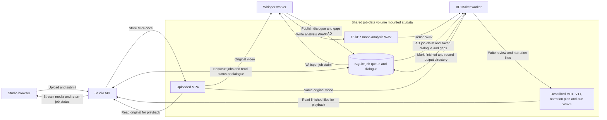

# Audio description worker integration

## Architecture



Studio, Whisper, and AD Maker run as three services. The workers pick
up jobs through `/data/studio-jobs.sqlite3`. They share the mounted video
and artifact files on the same host. Studio provides the HTTP interface
for browsers and other containers.

| Worker | Job stage | Reads | Publishes |
| --- | --- | --- | --- |
| `whisper` | `whisper` | `media_id`, selected device, original MP4 | Version 1 dialogue payload in SQLite, plus `work/analysis-audio.wav` in its attempt directory |
| `ad-maker` | `ad` | Same MP4, saved dialogue JSON and analysis WAV, selected device | Finished result directory in SQLite, plus the described MP4, subtitles, narration plan and WAVs |

## Whisper worker contract

Resolve the original video with `JobStore.source_path(job["media_id"])`.
Studio accepts an MP4 with an audio stream. Write the analysis audio as
**mono, 16,000 Hz, signed 16-bit PCM WAV** at
`<attempt_dir>/work/analysis-audio.wav`. The bundled runner also expects
`<attempt_dir>/work/dialogue-result.json` and publishes its contents to
`dialogue_results.payload` when the process exits successfully. The database
ties this record to the original upload through the job ID and media ID.

Example version 1 payload with illustrative values:

```json
{
  "schema_version": 1,
  "media": {"duration": 10.0, "width": 1280, "height": 720, "fps": 30.0, "has_audio": true},
  "transcript": {
    "report": {"backend": "example-asr", "validated_segments": 1, "validated_words": 1},
    "segments": [{"start": 1.0, "end": 1.6, "text": "Hello."}],
    "words": [{"start": 1.0, "end": 1.6, "text": "Hello."}],
    "raw_segments": [{"start": 1.0, "end": 1.6, "text": "Hello."}],
    "raw_words": [{"start": 1.0, "end": 1.6, "text": "Hello."}]
  },
  "dialogue_validation": {"method": "example-validation", "validated_words": 1},
  "speech_and_gaps": {
    "speech": [{"start": 0.9, "end": 1.7}],
    "gaps": [{"start": 1.9, "end": 9.8, "word_budget": 19}],
    "gap_audit": []
  }
}
```

- Use seconds from the start of the original video. Sort validated
  intervals by start time and keep the candidate gaps inside the video
  and outside the supplied speech intervals. `word_budget` is an integer
  estimate for the narration, which AD Maker checks again at synthesis.
- Use `probe_media()` in [pipeline.py](../offline_ad_poc/pipeline.py) to
  populate `media` when using the bundled AD Maker. It compares the
  entire `media` object with its own probe of the original video.
- Validated segment and word rows have exactly `start`, `end`, and
  `text`. Speech rows have `start` and `end`. Gap rows also have
  `word_budget`. AD Maker loads these rows into Python dataclasses.
  Keep provider-specific fields in `transcript.report` or
  `dialogue_validation`.
- Use empty arrays for empty results. A clip with no candidate gaps is
  valid. When present, gap audit rows can carry `start`, `end`,
  `gap_index`, `status`, and `reason`. AD Maker adds its own outcomes to
  the exported audit. The SQLite Whisper payload stays intact.
- Include `work/runtime-summary.json` to expose Whisper's stage timing in
  Studio. Studio serves that file as `dialogue-runtime-summary.json`.

## AD Maker contract

Read `JobStore.dialogue(job["id"])` to get the Whisper work directory and
the versioned JSON payload. Use the saved audio and the original video
returned by `source_path()`. The bundled worker writes the JSON to
`dialogue-input.json` and passes it to the pipeline with
`--dialogue-input` and `--analysis-audio`. Replacements can use different
visual models, prompt logic, or TTS implementations behind this boundary.

| Output path relative to the AD attempt directory | Consumer |
| --- | --- |
| `video-ad.mp4` | Studio player. Preserve the original audio and include an Audio Description track when cues exist. |
| `work/descriptions.vtt` | Studio AD caption lane and cue editor. |
| `work/narration-plan.json` and `work/narration/ad-NNN-try-N.wav` | TTS consumers and Studio result API. |
| `work/transcript.json` and `work/speech-and-gaps.json` | Dialogue and gap lanes in the finished Studio result. The original candidate intervals remain available through the dialogue API. |
| `work/runtime-summary.json`, `work/evaluation-report.json`, `work/shots.json`, `work/scenes.json`, and `work/ad-*.json` | Optional review and diagnostic artifacts. Preserve the existing structures when a replacement provides them. |

Example version 1 narration plan:

```json
{
  "schema_version": 1,
  "language": "en",
  "cues": [
    {
      "start": 3.2,
      "end": 5.6,
      "text": "A frog rests on a leaf.",
      "audio": "narration/ad-001-try-1.wav",
      "overlaps_dialogue": false,
      "dialogue_overlap_seconds": 0.0
    }
  ]
}
```

Sort cues by `start`. Use final placement times after synthesis.
`audio` is relative to the AD `work/` directory on disk and relative to
`/result/<job_id>/` over HTTP. Use the `ad-NNN-try-N.wav` naming convention
for Studio to serve the files. The overlap flags refer to the supplied
speech mask. A job with zero cues can publish `"cues": []` and an MP4 with the
original audio. The current AD Maker already runs TTS. An external TTS
consumer can reuse each cue's `start`, `end`, and `text`.

If you keep the bundled [runner](../offline_ad_poc/job_worker.py), have
your AD process emit `work/ad-decisions.json`. Its rows with
`decision: "AD"` and a nonempty `tts_path` must also provide
`cue_start`, `cue_end`, `description`, `overlaps_dialogue`, and
`dialogue_overlap_seconds`. Set `tts_path` to the absolute path of the
generated WAV inside the attempt's `work/narration/`. The runner derives
the versioned narration plan from those rows.

## Run or replace one worker

### Run the two processing stages directly

From the repository root in the existing Conda environment, set `VIDEO`
to an MP4 with audio and use the already downloaded checkpoints and the
Conda `llama-mtmd-cli` on PATH:

```bash
VIDEO=/absolute/path/to/input.mp4
RUN=$(mktemp -d)
MODELS="$PWD/models"

python -m offline_ad_poc.pipeline \
  --dialogue-only --input "$VIDEO" --work-dir "$RUN/whisper" --device cpu \
  --asr-backend transformers --asr-model "$MODELS/whisper-tiny.en"

python -m offline_ad_poc.pipeline \
  --input "$VIDEO" --dialogue-input "$RUN/whisper/dialogue-result.json" \
  --analysis-audio "$RUN/whisper/analysis-audio.wav" \
  --output-video "$RUN/video-ad.mp4" --work-dir "$RUN/ad" --device cpu \
  --visual-backend qwen3vl \
  --vlm-model "$MODELS/qwen3-vl-2b-instruct-gguf/Qwen3VL-2B-Instruct-Q4_K_M.gguf" \
  --vlm-mmproj "$MODELS/qwen3-vl-2b-instruct-gguf/mmproj-Qwen3VL-2B-Instruct-Q8_0.gguf" \
  --evidence-frames 2 --evidence-max-edge 384 --event-followups 0 \
  --tts-backend transformers --tts-model "$MODELS/mms-tts-eng-local"

python -c 'import sys; from pathlib import Path; from offline_ad_poc.job_worker import write_narration_plan; write_narration_plan(Path(sys.argv[1]))' "$RUN/ad"
```

The direct commands leave the files in `$RUN`. The runner adds database
publication in the Compose deployment.

### Integrate a replacement container

1. Keep the existing [worker runner](../offline_ad_poc/job_worker.py) and
   adapt its `pipeline_args()` to invoke your processor. This keeps the
   claim loop, timeouts, heartbeat, output publication, and retry handling.
2. A custom runner can use [JobStore](../offline_ad_poc/job_store.py)
   directly. Send `report_worker(role, host, profile, cuda, preparer)`
   periodically while idle and running. Call `claim(role, cuda, host)`
   with role `whisper` or `ad`, use the returned `selected_device` and
   write inside the returned `attempt_dir`. Renew the claim periodically
   during processing. The current lease is 30 seconds and the bundled
   runner renews about every five seconds.
3. Publish after all required files are ready. Call
   `finish_dialogue(claim, payload)` for Whisper or `finish_ad(claim)` for
   AD Maker. `finish_dialogue` stores the payload and queues AD in the
   same transaction. If `renew()` or a finish call returns `False`, the
   worker has lost its claim. Stop that attempt. Use `fail(claim, error)`
   for a processing error. Each retry gets its own attempt directory.

For example, build an image called `local/ad-maker:dev` that includes
the adapted runner. Use this `compose.replacement.yaml` beside
[compose.yaml](../compose.yaml):

```yaml
services:
  ad-maker:
    image: local/ad-maker:dev
    build: !reset null
```

The replacement image in this example accepts the inherited
`python -m offline_ad_poc.job_worker ad ...` command. Set `command` in
the override if your image uses another adapter entry point. To replace
Whisper instead, override the `whisper` service and accept role
`whisper`. Keep the existing writable `/data` mount and share files
with the other services.

```bash
docker compose -f compose.yaml -f compose.replacement.yaml config
docker compose -f compose.yaml -f compose.replacement.yaml up -d --no-deps --no-build ad-maker
```

### Verify the handoff through Studio

Use `http://127.0.0.1:7860` from the host or `http://studio:7860` from a
container on the Compose network.

| Request | What to check |
| --- | --- |
| `POST /api/media` with raw MP4 bytes | Returns the media ID. |
| `POST /api/media/<media_id>/generate` with JSON `{"device":"cpu","title":"Worker smoke test"}` | Returns a job ID with HTTP 202. |
| `GET /api/jobs/<job_id>` | Stage moves from `whisper` to `ad` to `complete`. A finished job provides the artifact URLs in `files`. |
| `GET /api/jobs/<job_id>/dialogue` | Returns HTTP 409 before Whisper saves the result, then the version 1 payload. AD should use that same payload after restart. |
| `GET /result/<job_id>/narration-plan.json` | Returns the final cues and relative WAV paths. |
| `GET /result/<job_id>/video-ad.mp4` with `Range: bytes=0-63` | Returns HTTP 206 and a `Content-Range` header. Check the same for a cue WAV when the job has cues. |

Run `python -m unittest discover -s tests -p test_split_jobs.py -v` for
the claim, handoff, and narration-plan tests. For a replacement smoke
test, use a short real clip with dialogue and a known speech-free
interval. Check the downstream worker can reopen the persisted result
and that the produced subtitle and WAV times agree with the plan.
